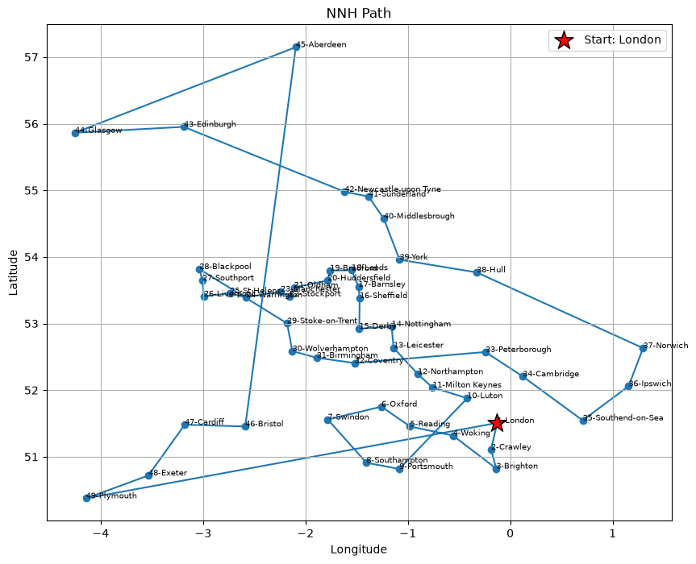
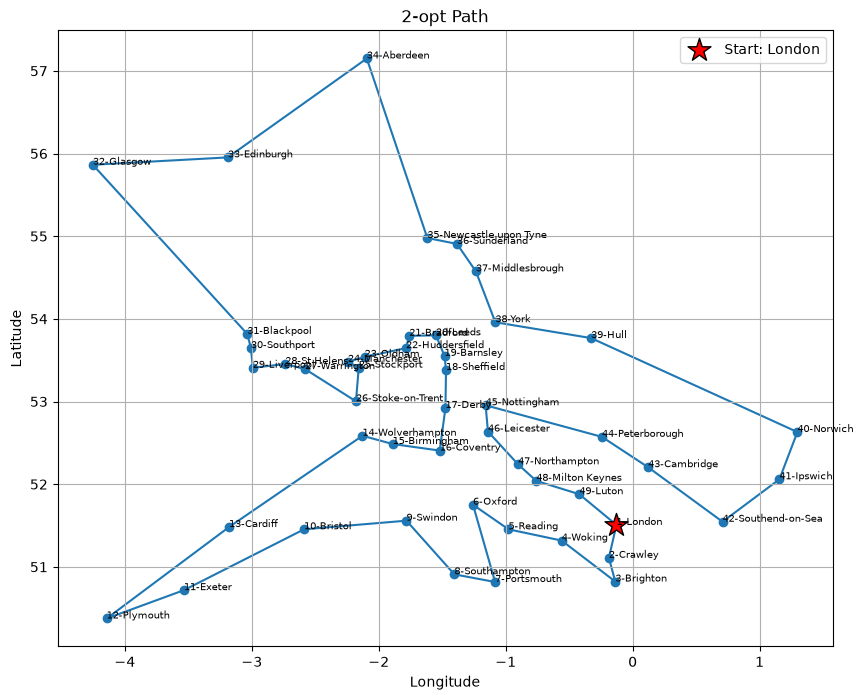
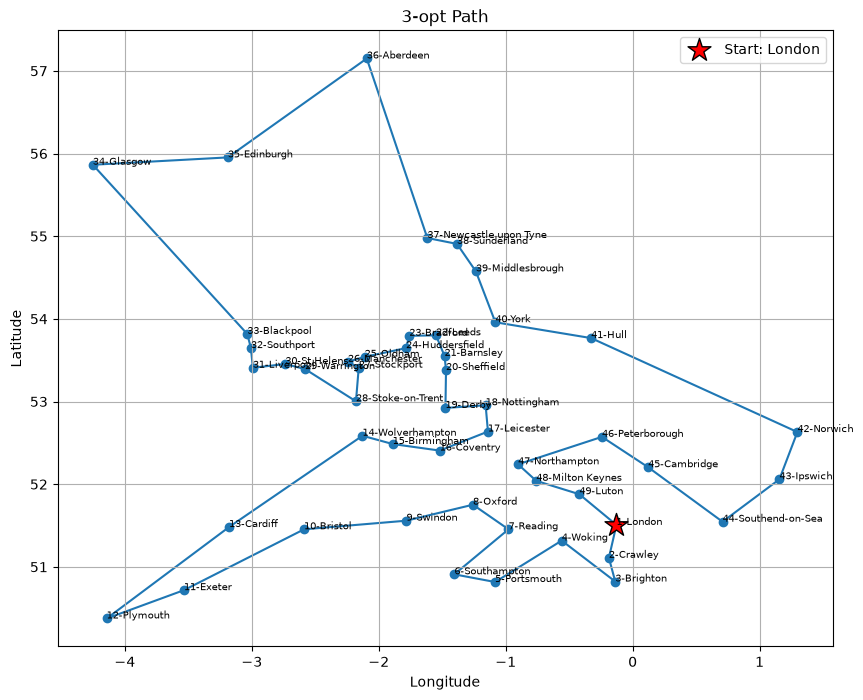
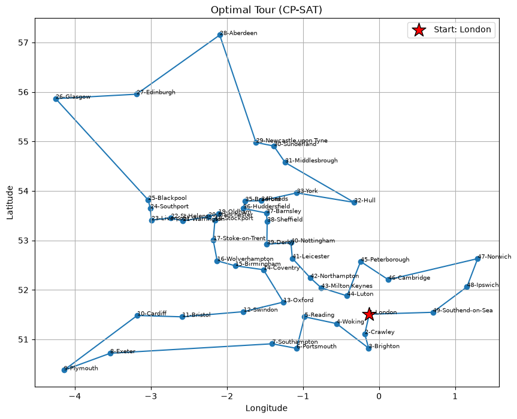

# UK Cities Travelling Salesman Problem

Solving the Travelling Salesman Problem (TSP) for 49 UK cities in Python. The notebook builds a tour with a constructive heuristic, improves it with local search, and then solves the instance to **proven optimality** with CP-SAT to measure how far each heuristic is from the best possible tour.

## Problem

Starting from London, visit each of the 49 cities exactly once and return to the start, minimizing the total travel distance.

## Dataset

[Travelling Salesman Problem: Visit 49 UK Cities](https://www.kaggle.com/datasets/patricklford/travelling-salesman-problem) on Kaggle (author: patricklford).

| Column | Description |
|---|---|
| `City` | City name |
| `Latitude` | Latitude in degrees |
| `Longitude` | Longitude in degrees |
| `Population` | Population (dropped, not used by the model) |

Place the downloaded file next to the notebook as `UK_Cities.csv`. 

**Liciense**: the dataset is released under [CC0 1.0](https://creativecommons.org/publicdomain/zero/1.0/).

## Methods

| Step | Method | Notes |
|---|---|---|
| 1 | Nearest Neighbour Heuristic (NNH) | Constructive heuristic, starts from index 0 (London) by default |
| 2 | 2-opt | Local search, evaluates each swap with an O(1) delta instead of recomputing the whole tour |
| 3 | 3-opt | Local search over all 7 reconnections, also with O(1) delta evaluation |
| 4 | Exact solution with CP-SAT | OR-Tools `AddCircuit` constraint, warm-started with the 3-opt tour |

Distances are Euclidean distances computed on the (latitude, longitude) coordinates and stored in a precomputed matrix (`scipy.spatial.distance.pdist` + `squareform`).

## Results

| Method | Total distance | Gap to optimal |
|---|---|---|
| Nearest Neighbour | 37.49 | ~22.2% |
| + 2-opt | 31.57 | ~2.9% |
| + 3-opt | 30.93 | 0.83% |
| **CP-SAT (optimal)** | **30.68** | 0% |

CP-SAT reports status `OPTIMAL` (lower bound 30.6806). Distances are in coordinate degrees, not kilometres (see [Limitations](#limitations)).

| Nearest Neighbour | 2-opt |
|---|---|
|  |  |

| 3-opt | Optimal (CP-SAT) |
|---|---|
|  |  |

The red star marks the starting city.

## Project structure

```
.
├── notebook.ipynb     # Data loading, heuristics, exact solver, plots
├── UK_Cities.csv      # Dataset from Kaggle
├── images/            # Tour plots used in this README
└── README.md
```

## Getting started

1. Create and activate a virtual environment (the project was developed with Python 3.14).

   ```bash
   python -m venv .venv
   # Windows
   .venv\Scripts\activate
   # macOS / Linux
   source .venv/bin/activate
   ```

2. Install the dependencies.

   ```bash
   pip install -r requirements.txt
   ```

3. Open `notebook.ipynb` in VS Code or Jupyter, select the `.venv` kernel, and choose **Run All**.

## How it works

- **Data loading**: each row of the CSV is stored as a single quoted field, so the notebook splits the first column on commas and converts the coordinates to numeric types.
- **Tour representation**: a tour is a list of city indices. Helper functions accept either city names or indices, and `get_total_distance` computes the length of the closed tour with a vectorized lookup in the distance matrix.
- **Local search**: 2-opt and 3-opt only compare the removed and added edges of a move, so each candidate costs O(1) instead of O(n). They repeat until no improving move is found.
- **Exact solver**: CP-SAT only handles integer costs, so distances are scaled by 10,000 and rounded. The optimum is therefore exact for the scaled distances, which differ from the real ones by a negligible rounding error.

## Limitations

- Euclidean distance on latitude and longitude is only an approximation. One degree of longitude is shorter than one degree of latitude in the UK, so the tour is optimal for this distance measure but not necessarily for real road or great-circle distances. Replacing the distance matrix with haversine (great-circle) distances in kilometres would fix this without changing the algorithms.
- 3-opt scales as O(n³) per pass. It is fast for 49 cities, but larger instances need neighbour lists or Or-opt, or a compiled implementation.

## Acknowledgements

Dataset by [patricklford](https://www.kaggle.com/datasets/patricklford/travelling-salesman-problem) on Kaggle, licensed under [CC0 1.0 Universal (Public Domain Dedication)](https://creativecommons.org/publicdomain/zero/1.0/). Exact solver: [Google OR-Tools](https://developers.google.com/optimization).
